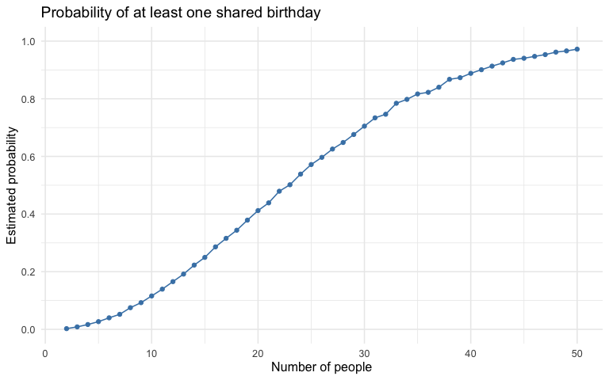
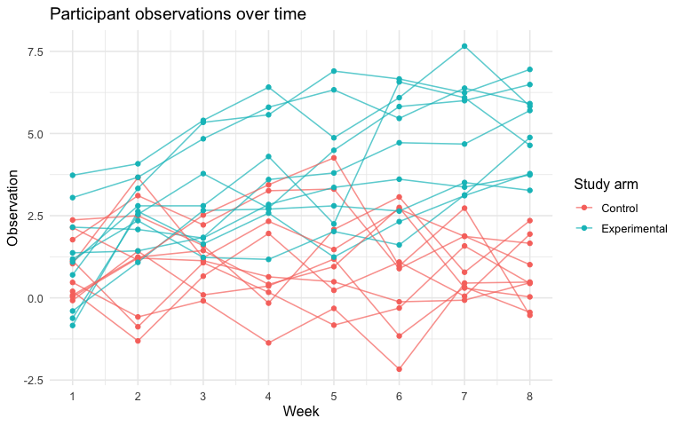
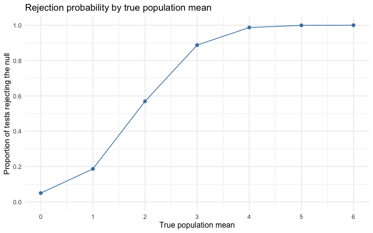
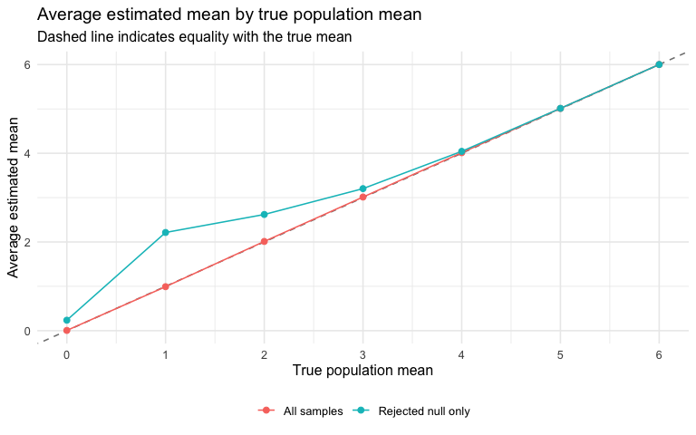

p8105_hw5_hs3653.Rmd
================
Hyder Said
2026-11-16

## Problem 1

Simulated birthdays for groups of 2-50 people and estimated the
probability of at least one shared birthday using 10,000 simulations per
group size

``` r
shared_birthday = function(n) {

  birthdays = sample(1:365, size = n, replace = TRUE)

  any(duplicated(birthdays))

}

birthday_results =
  expand_grid(
    group_size = 2:50,
    iter = 1:10000
  ) |>
  mutate(
    shared = map_lgl(group_size, shared_birthday)
  )

birthday_summary =
  birthday_results |>
  group_by(group_size) |>
  summarize(
    probability = mean(shared),
    .groups = "drop"
  )
```

``` r
birthday_summary |>
  ggplot(aes(x = group_size, y = probability)) +
  geom_line(color = "steelblue") +
  geom_point(color = "steelblue", size = 1.5) +
  labs(
    title = "Probability of at least one shared birthday",
    x = "Number of people",
    y = "Estimated probability"
  ) +
  scale_y_continuous(
    limits = c(0, 1),
    breaks = seq(0, 1, 0.2)
  ) +
  theme_minimal(base_size = 12)
```

<!-- -->

Across 10,000 simulations per group size, the estimated probability of
at least one shared birthday increased with group size. For example, the
probability was 0.28% with 2 people, 57.5% with 25 people, and 96.8%
with 50 people. This occurs because larger groups contain more pairs of
people who could share a birthday.

## Problem 2

Combined the participant files into a “tidy” dataset with 1 row per
participant/week and plotted individual trajectories by study arm

``` r
# Create a tidy dataframe containing data from all participants
study_df =
  tibble(
    file_name = list.files(
      path = "data",
      pattern = "\\.csv$"
    )
  ) |>
  mutate(
    data = purrr::map(
      file_name,
      \(file) read_csv(str_c("data/", file))
    )
  )

# Extract arm and subject ID, combine data, and "tidy" weekly observations
study_tidy =
  study_df |>
  mutate(
    file_name = str_replace(file_name, "\\.csv$", "")
  ) |>
  separate(
    file_name,
    into = c("arm", "subject_id"),
    sep = "_"
  ) |>
  mutate(
    arm = recode(
      arm,
      con = "Control",
      exp = "Experimental"
    )
  ) |>
  unnest(cols = data) |>
  pivot_longer(
    cols = starts_with("week_"),
    names_to = "week",
    names_prefix = "week_",
    values_to = "observation"
  ) |>
  mutate(
    week = as.integer(week)
  )

study_tidy
```

    ## # A tibble: 160 × 4
    ##    arm     subject_id  week observation
    ##    <chr>   <chr>      <int>       <dbl>
    ##  1 Control 01             1        0.2 
    ##  2 Control 01             2       -1.31
    ##  3 Control 01             3        0.66
    ##  4 Control 01             4        1.96
    ##  5 Control 01             5        0.23
    ##  6 Control 01             6        1.09
    ##  7 Control 01             7        0.05
    ##  8 Control 01             8        1.94
    ##  9 Control 02             1        1.13
    ## 10 Control 02             2       -0.88
    ## # ℹ 150 more rows

``` r
study_tidy |>
  ggplot(
    aes(
      x = week,
      y = observation,
      group = interaction(arm, subject_id),
      color = arm
    )
  ) +
  geom_line(alpha = 0.7) +
  geom_point(size = 1.5) +
  scale_x_continuous(breaks = 1:8) +
  labs(
    title = "Participant observations over time",
    x = "Week",
    y = "Observation",
    color = "Study arm"
  ) +
  theme_minimal(base_size = 12)
```

<!-- -->

Observations in the control and experimental arms followed different
trajectories over the eight-week period. The experimental arm generally
showed increasing observations, while the control arm remained
relatively stable with no consistent trend. The groups overlapped
initially but became more separated at later weeks, with higher
observations in the experimental arm. Both groups showed variation
between participants and week-to-week fluctuations within participants.

## Problem 3

Generated 5,000 normally distributed datasets for each true mean from 0
to 6, fixing the sample size at 30 and standard deviation at 5, and
applied a two-sided one-sample t-test against a null mean of zero.

``` r
sim_t_test = function(mu, n = 30, sigma = 5) {

  sim_data =
    tibble(
      x = rnorm(n, mean = mu, sd = sigma)
    )

  t.test(sim_data$x, mu = 0) |>
    broom::tidy() |>
    select(
      mu_hat = estimate,
      p_value = p.value
    )

}

sim_t_test(mu = 0)
```

    ## # A tibble: 1 × 2
    ##   mu_hat p_value
    ##    <dbl>   <dbl>
    ## 1  -1.62  0.0545

``` r
t_test_results =
  expand_grid(
    true_mu = 0:6,
    iter = 1:5000
  ) |>
  mutate(
    results = map(true_mu, sim_t_test)
  ) |>
  unnest(cols = results) |>
  mutate(
    rejected = p_value < 0.05
  )

t_test_results
```

    ## # A tibble: 35,000 × 5
    ##    true_mu  iter  mu_hat p_value rejected
    ##      <int> <int>   <dbl>   <dbl> <lgl>   
    ##  1       0     1 -0.542   0.569  FALSE   
    ##  2       0     2 -0.278   0.767  FALSE   
    ##  3       0     3 -0.303   0.733  FALSE   
    ##  4       0     4  0.406   0.637  FALSE   
    ##  5       0     5  0.147   0.881  FALSE   
    ##  6       0     6  1.20    0.191  FALSE   
    ##  7       0     7 -0.0542  0.957  FALSE   
    ##  8       0     8 -0.119   0.878  FALSE   
    ##  9       0     9 -1.89    0.0712 FALSE   
    ## 10       0    10 -1.35    0.209  FALSE   
    ## # ℹ 34,990 more rows

``` r
power_summary =
  t_test_results |>
  group_by(true_mu) |>
  summarize(
    rejection_rate = mean(rejected),
    .groups = "drop"
  )

power_summary
```

    ## # A tibble: 7 × 2
    ##   true_mu rejection_rate
    ##     <int>          <dbl>
    ## 1       0          0.05 
    ## 2       1          0.187
    ## 3       2          0.569
    ## 4       3          0.887
    ## 5       4          0.987
    ## 6       5          0.999
    ## 7       6          1

``` r
power_summary |>
  ggplot(aes(x = true_mu, y = rejection_rate)) +
  geom_line(color = "steelblue") +
  geom_point(color = "steelblue", size = 2) +
  scale_x_continuous(breaks = 0:6) +
  scale_y_continuous(
    limits = c(0, 1),
    breaks = seq(0, 1, 0.2)
  ) +
  labs(
    title = "Rejection probability by true population mean",
    x = "True population mean",
    y = "Proportion of tests rejecting the null"
  ) +
  theme_minimal(base_size = 12)
```

<!-- -->

With sample size and standard deviation fixed, power increased as the
true population mean moved further from the null value of 0,
corresponding to a larger effect size. For example, power was 18.4% at a
true mean of 1, 56.7% at 2, and 89.2% at 3, approaching 100% for true
means ≥4. Larger effects were therefore more likely to be detected with
the same sample size and variability. When the true mean was 0, 5.16% of
tests rejected the null, close to the expected Type I error rate of 5%.

``` r
estimate_summary =
  t_test_results |>
  group_by(true_mu) |>
  summarize(
    mean_all = mean(mu_hat),
    mean_rejected = mean(mu_hat[rejected]),
    .groups = "drop"
  )

estimate_summary
```

    ## # A tibble: 7 × 3
    ##   true_mu mean_all mean_rejected
    ##     <int>    <dbl>         <dbl>
    ## 1       0  0.00545         0.236
    ## 2       1  0.992           2.21 
    ## 3       2  2.01            2.62 
    ## 4       3  3.01            3.20 
    ## 5       4  4.01            4.04 
    ## 6       5  5.01            5.01 
    ## 7       6  6.00            6.00

``` r
estimate_summary |>
  pivot_longer(
    cols = c(mean_all, mean_rejected),
    names_to = "samples",
    values_to = "average_estimate"
  ) |>
  mutate(
    samples = recode(
      samples,
      mean_all = "All samples",
      mean_rejected = "Rejected null only"
    )
  ) |>
  ggplot(
    aes(
      x = true_mu,
      y = average_estimate,
      color = samples
    )
  ) +
  geom_abline(
    intercept = 0,
    slope = 1,
    linetype = "dashed",
    color = "gray50"
  ) +
  geom_line() +
  geom_point(size = 2) +
  scale_x_continuous(breaks = 0:6) +
  labs(
    title = "Average estimated mean by true population mean",
    subtitle = "Dashed line indicates equality with the true mean",
    x = "True population mean",
    y = "Average estimated mean",
    color = NULL
  ) +
  theme_minimal(base_size = 12) +
  theme(legend.position = "bottom")
```

<!-- -->

Across all simulated datasets, the average estimated mean was close to
the true mean. Among datasets that rejected the null (p \< 0.05), small
positive effects were overestimated. For example, when the true mean was
1, the average estimate among significant datasets was 2.24. Because
sample means vary across datasets, selecting only significant results
favors higher estimates and raises the average above the true mean. As
power increased, nearly all datasets rejected the null, and the average
estimate approached the true mean. When the true mean was 0, positive
and negative significant estimates tended to cancel out, leaving an
average close to zero both for all samples and for the rejected null
subset.
